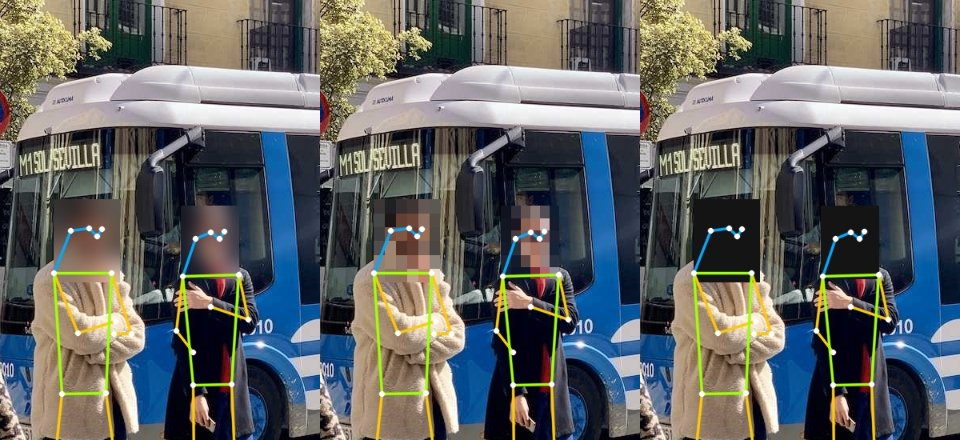

<div align="center">


# Evidone Pose Detection

**Real-Time Pose Detection with Face Anonymization**

[](https://github.com/rogercasy/evidone-exercise/actions/workflows/qa.yml)
[](https://github.com/rogercasy/evidone-exercise/releases/latest)
[](https://www.python.org/)
<br>
[](https://github.com/astral-sh/uv)
[](https://github.com/astral-sh/ruff)
[](https://mypy-lang.org/)

<!-- Badges to move into the rows above once they apply:
[](https://pypi.org/project/evidone_exercise/)
[](https://github.com/rogercasy/evidone-exercise/pkgs/container/evidone-exercise)
[](https://evidone-exercise.readthedocs.io)
-->

[Features](#features) · [Requirements](#requirements) · [Setup](#setup) · [Usage](#usage)
<br>
[Assumptions](#assumptions) · [Development](#development) · [Contributing](#contributing)

</div>

---

Tracks the pose of everyone in a camera feed or a video, and hides their faces while doing it.



## Features

- Real-time pose detection on the CPU for everyone in frame, 17 keypoints each.
- Automatic face hiding: blur, pixelation or a solid fill.
- Skeleton overlay with head, torso and limbs coloured apart.
- FPS, inference time and people count on screen.
- Webcam by device index, or a video file on a loop.
- Everything switchable while it runs, from the toolbar.
- Optional outputs: an mp4 of the processed video and a JSON Lines log of every box and keypoint.

## Requirements

- Python 3.12 or newer
- [uv](https://docs.astral.sh/uv/)
- A camera exposed to the OS (`/dev/video*` on Linux)
- On a minimal Linux box, the system libraries Qt links against:
  `libegl1 libgl1 libxkbcommon0 libdbus-1-3`

## Setup

```bash
uv sync
```

## Usage

```bash
uv run evidone
```

The first run downloads the pose weights (`yolo26n-pose.pt`, ~7.6 MB) into the working directory;
they are gitignored.

Two options set the starting values:

| Option | Default | What it does |
| --- | --- | --- |
| `--camera INDEX` | `0` | Camera device index to open. |
| `--confidence SCORE` | `0.4` | Minimum detection confidence, above 0 and up to 1. |

```bash
uv run evidone --camera 1 --confidence 0.5
```

Both are starting values only. The toolbar changes them while the app runs, along with the source,
how faces are hidden, the skeleton and the optional recording and JSON log. `Q` or `Esc` closes the
window.

## Assumptions and Design Decisions

- **CPU inference:** I chose the YOLO26 nano pose model to keep the application lightweight and make sure it runs on a regular laptop without a GPU.
- **Face detection:** Face regions are estimated directly from the pose keypoints, without using a separate face detector. When facial keypoints are missing, I use the shoulders or person bounding box as a fallback.
- **Face anonymization:** I added some basic tracking and smoothing between frames to avoid flickering when detections are unstable. This may occasionally blur an area for a few extra frames, but I preferred that over exposing a face.
- **Performance:** Inference time is measured around the complete prediction call, including preprocessing and postprocessing.
- **Visualization:** Skeletons and keypoints are drawn directly with OpenCV instead of using Ultralytics' built-in visualization functions.
- **Implementation:** I kept the dependencies and data structures simple, focusing on readability and the requirements of the exercise.


## How I used AI assistants

I worked through Claude Code, one issue at a time. I wrote each prompt myself, stating the goal and the constraints but not the solution: the thresholds, the fallbacks and the structure were its calls to make, and mine to accept or send back.
Nothing landed unreviewed. I read every diff, rejected what I disagreed with, and asked for another pass when the result was close but wrong. Pull request descriptions were written from the diff rather than from the conversation, so they describe what shipped instead of what was planned.

The assistant's own account of how we worked is in [AI-USAGE.md](AI-USAGE.md), with the session transcripts next to it.

## Development

Setup, QA, releases and CI: [DEVELOPMENT.md](DEVELOPMENT.md).

## Contributing

Issues and pull requests are welcome; `make qa` must pass.

---

<sub>🚀 Project starter provided by [Cookie Pyrate v1.1.0](https://github.com/gvieralopez/cookie-pyrate/tree/v1.1.0)</sub>
